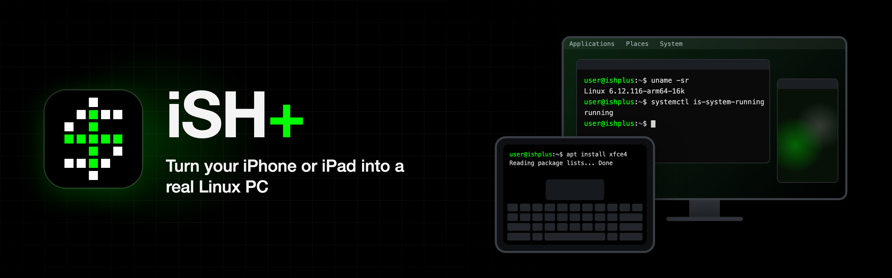

  

  
  
  

  <b>A real Linux kernel on your iPhone or iPad</b>, with the distribution of your choice, 
  its own init system and services, a desktop, and a laptop mode for external monitors.

  <a href="https://intradeus.github.io/http-protocol-redirector?r=sidestore%3A%2F%2Fsource%3Furl%3Dhttps%3A%2F%2Fraw.githubusercontent.com%2Fjohnnydevelops%2Fish-plus%2Fmain%2Fsource.json"><b>Add to SideStore</b></a>
  &nbsp;·&nbsp;
  <a href="https://github.com/johnnydevelops/ish-plus/releases/latest"><b>Download the .ipa</b></a>
  &nbsp;·&nbsp;
  <a href="docs/setup.md"><b>Setup guide</b></a>

---

iSH+ is a fork of [iSH](https://github.com/ish-app/ish). Where iSH emulates an x86 processor and translates Linux system calls itself, iSH+ runs a genuine Linux kernel (Debian's 6.12) in [QEMU](https://www.qemu.org) with a JIT, so programs see a real Linux system. Because it needs JIT, it is sideloaded rather than on the App Store, and it can enable JIT by itself, without a computer.

## Features

- **Any distribution**: Alpine, Debian, Ubuntu, Arch, Fedora, openSUSE, Void, Kali and more, downloaded in the app, each with your own account.
- **Each distribution's own init**: systemd, OpenRC, runit or sysvinit boot as on a computer, so services, timers and `systemctl` work.
- **Fast**: A JIT enabled on the device, and an ARM-to-ARM translator that runs most instructions as themselves.
- **Desktop, X11 or Wayland**: Install Xfce, GNOME, KDE, sway and others; every one installed appears in the sessions menu.
- **Laptop mode**: Connect a monitor over HDMI or AirPlay to see Linux at full resolution, and your device becomes the keyboard and trackpad. Half-folded, an iPhone Duo becomes a mini laptop.
- **Mouse capture**: On iPad, a mouse or trackpad is captured automatically on the desktop, as in UTM.
- **Sound and microphone**: PipeWire and PulseAudio work as on a computer.
- **x86_64 programs**: Run through [FEX](https://fex-emu.com), with `apt-x86 install` and `x86 <command>`.
- **GPU acceleration**: OpenGL through ANGLE and Metal, plus experimental Vulkan. [Details](docs/gpu.md)
- **Android (LineageOS 17.1)**: Run real Android 10 inside the Linux VM via Waydroid/LXC, with SurfaceFlinger routed through the same Metal GPU path. Optimized for 3–4 GB A13 devices. [Details](docs/lineageos.md)
- **iOS integration**: `~/iOS` is the Files app's iSH+ folder, plus `pbcopy`/`pbpaste`, Shortcuts, and servers opening in Safari.
- **More memory**: Up to 60% of the device's RAM for Linux, plus compressed swap.
- **Security keys**: `ssh` `sk-` keys over NFC (iPhone) or USB-C.
- **Instant resume**: Linux is saved in the background, so you resume where you were.

## Getting started

1. **Install iSH+.** [Add the source to SideStore](https://intradeus.github.io/http-protocol-redirector?r=sidestore%3A%2F%2Fsource%3Furl%3Dhttps%3A%2F%2Fraw.githubusercontent.com%2Fjohnnydevelops%2Fish-plus%2Fmain%2Fsource.json) for updates. You can also add `https://raw.githubusercontent.com/johnnydevelops/ish-plus/main/source.json` in SideStore, AltStore or Feather, or sideload the [.ipa](https://github.com/johnnydevelops/ish-plus/releases/latest).
2. **Install [LocalDevVPN](https://apps.apple.com/search?term=LocalDevVPN)** and turn on Developer Mode.
3. **Open iSH+ and follow the setup.** It pairs with your device, then you choose a distribution and create your account.

Requires iOS 18 or later. On iOS 27, iSH+ pairs on the device; before that, make a pairing file with [iloader](https://iloader.app) on a computer. The [setup guide](docs/setup.md) covers VPNs such as Tailscale, sideloader entitlements, and iSH+'s lighter init.

## Documentation

- [Setup guide](docs/setup.md): installing, JIT, VPNs, entitlements
- [GPU acceleration](docs/gpu.md): OpenGL, Vulkan, limitations
- [LineageOS 17.1 / Android 10](docs/lineageos.md): Waydroid/LXC in the guest, Metal GPU bridge, A13 RAM tuning
- [How it works](docs/how-it-works.md): QEMU in-process, JIT, memory donors, the guest
- [Building](docs/building.md): building iSH+ yourself

## Credits

iSH+ builds on [iSH](https://github.com/ish-app/ish) by Theodore Dubois and contributors, [QEMU](https://www.qemu.org) and [UTM](https://github.com/utmapp/UTM)'s iOS work on it, and [libslirp](https://gitlab.freedesktop.org/slirp/libslirp).

All credits

- For GPU acceleration, [UTM](https://github.com/utmapp/UTM)'s forks of [virglrenderer](https://gitlab.freedesktop.org/virgl/virglrenderer) (MIT), [ANGLE](https://chromium.googlesource.com/angle/angle) (BSD-3-Clause, from UTM's WebKit), [libepoxy](https://github.com/anholt/libepoxy) (MIT) and [MoltenVK](https://github.com/KhronosGroup/MoltenVK) with [SPIRV-Cross](https://github.com/KhronosGroup/SPIRV-Cross) (Apache-2.0), with iSH+'s patches in `tools/qemu-ios-patches`
- [SwiftTerm](https://github.com/migueldeicaza/SwiftTerm) (MIT)
- [StikJIT](https://github.com/StikDebug/StikJIT) (MPL-2.0), downloaded at build time, and [idevice](https://github.com/jkcoxson/idevice) (MIT)
- [FEX](https://fex-emu.com) (MIT), with Ubuntu's x86_64 base system
- [Alpine Linux](https://alpinelinux.org)'s kernel, initramfs and tools, and the distributions from [Linux Containers](https://images.linuxcontainers.org) and [Armtix](https://armtix.artixlinux.org)
- Distribution logos from [Simple Icons](https://simpleicons.org) (CC0); they are trademarks of their owners
- [MeloNX](https://starforgejo.dev/projects/MeloNX)'s RAM donor technique and its way of presenting on external displays, by Stossy11 (MIT)
- [Debian](https://www.debian.org)'s 16 KB-page arm64 kernel
- The ideas of [Madeira](https://github.com/willfaust/Madeira), [StikDebug](https://github.com/StikDebug/StikDebug) and StikPair for enabling JIT on the device

## License

iSH+ is licensed like iSH: under the GPL version 3 (with the terms in `LICENSE.IOS`), and version 2 for code since iSH's relicensing, so it can be used with QEMU and Linux. See [`LICENSE.md`](LICENSE.md).
